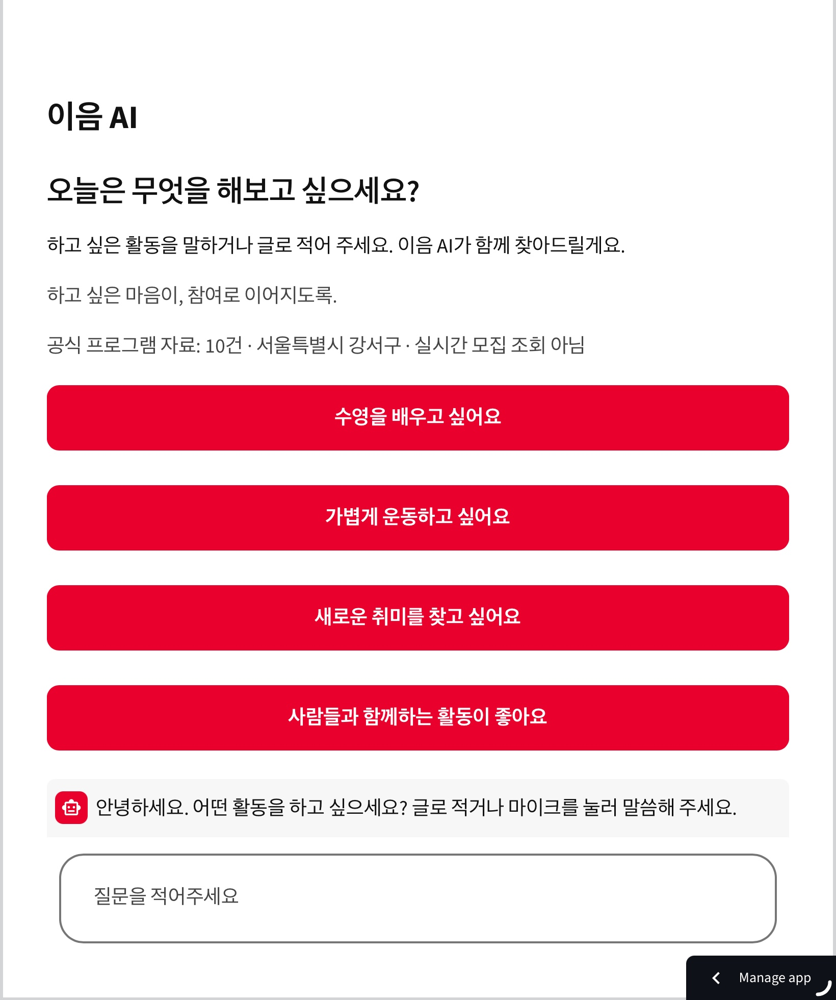
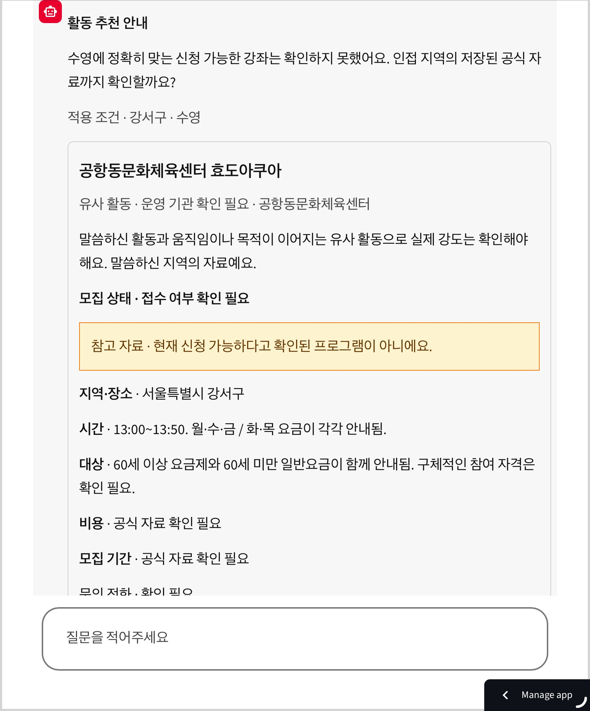
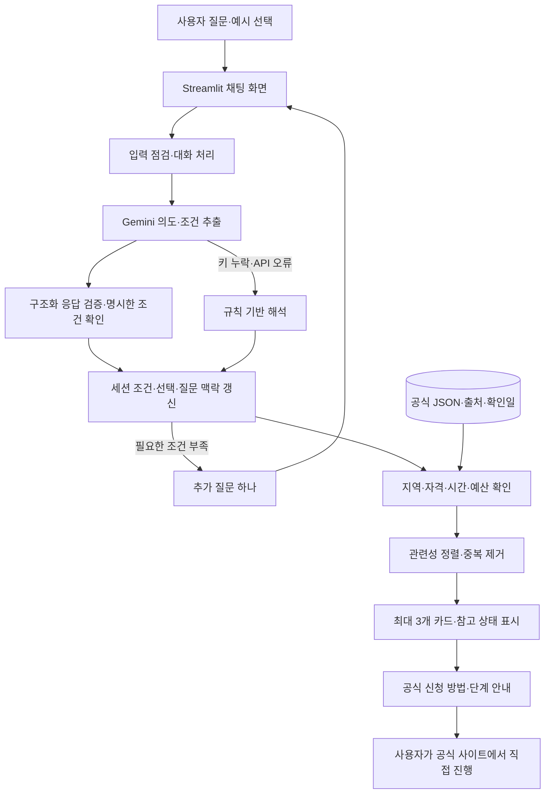

# 이음 AI · IEUM AI

### 하고 싶은 마음이, 참여로 이어지도록.

**어르신이 하고 싶은 여가·체육·문화 활동을 일상적인 말로 이야기하면, 필요한 조건을 확인하고 공식 프로그램 정보와 참여 방법을 안내하는 AI 도우미입니다.**

기관 이름이나 검색어를 미리 알지 못해도 괜찮습니다. “수영을 배우고 싶어요”, “사람들과 함께하는 활동이 좋아요”처럼 관심에서 시작해 활동을 발견하고, 정보를 이해하며, 참여 여부를 스스로 결정하도록 돕고자 합니다.

[배포 앱 이용하기](https://ieum-ai-demo.streamlit.app) · [개발 PR 기록](https://github.com/alstj0606/ieum-ai/pulls?q=is%3Apr) · [트러블슈팅](docs/troubleshooting.md)

> 현재는 서울 강서구 공식 자료 **10건**을 사용하는 시제품입니다. 실시간 모집·잔여석 조회나 자동 신청 서비스는 아닙니다. 자료가 없거나 확인되지 않았다면 그 한계를 함께 안내합니다.

## 1. 왜 만들었나요?

미국에서 생활하며 어르신들끼리 놀이동산에 방문하거나 노부부가 함께 여가를 즐기는 모습을 보았습니다. 나이가 들어서도 새로운 경험을 발견하고 즐길 수 있다는 장면에서 질문이 시작됐습니다.

**“어떤 활동이 있는지 모르거나, 신청 방법이 어려워 참여할 기회를 놓치고 있지는 않을까?”**

할머니의 온라인 수영 강좌 신청 경험은 이 질문을 더 구체적인 문제로 연결했습니다. 관심 있는 활동을 찾더라도 여러 홈페이지와 공고에서 시간·비용·자격을 비교하고, 낯선 신청 절차를 따라가야 했습니다.

이음 AI는 검색 결과를 많이 나열하기보다 다음 세 가지 어려움을 줄이는 데 집중합니다.

| 어려움 | 이음 AI의 접근 |
| --- | --- |
| 무엇이 있는지, 어떤 말로 검색해야 하는지 모름 | 평소 쓰는 말과 예시 질문으로 시작 |
| 시간·비용·대상·접수 상태를 비교하기 어려움 | 공식 자료를 같은 형식의 큰 카드로 표시 |
| 정보를 찾은 뒤 신청 방법에서 막힘 | 확인된 신청 방법과 공식 페이지, 가능한 범위의 단계별 안내 제공 |

이 문제의식은 개인 경험에서 출발했습니다. 전체 고령층을 대상으로 효과를 입증한 연구나 사용성 평가 결과는 아닙니다.

## 2. 실제 사용 화면

아래는 작성자가 실제 배포 앱에서 촬영한 초기 화면과 질문 후 답변 화면입니다. 로컬 자동 테스트 화면과 구분합니다.

### 첫 화면 — 하고 싶은 활동에서 시작

“오늘은 무엇을 해보고 싶으세요?”라는 질문과 네 가지 큰 예시 버튼을 표시합니다. 특정 복지관의 회원 여부보다 사용자의 관심이 먼저입니다. 자료 10건·강서구 범위·실시간 모집 조회가 아니라는 점도 함께 알립니다.



### 추천 화면 — 비슷한 활동과 미확인 정보를 구분

제공된 수영 질문 결과 화면에서는 ‘공항동문화체육센터 효도아쿠아’를 **유사 활동**으로 표시합니다. 수영 강습과 동일하다고 표현하지 않고, 접수 여부·비용·모집 기간의 미확인 상태와 참고 자료임을 명시합니다.



이 화면은 배포 앱의 화면 표시를 확인하는 자료입니다. Gemini API 성공, 음성 인식 성공, 실제 프로그램 신청 가능 여부까지 증명하지는 않습니다.

## 3. 어떻게 이용하나요?

1. **관심 말하기:** 글로 질문하거나 예시 버튼을 선택합니다. 음성 설정이 있는 환경에서는 마이크도 사용할 수 있습니다.
2. **필요한 조건 확인:** 지역 등 부족한 조건을 한 번에 하나씩 묻습니다. 이미 말한 조건은 현재 세션에서 유지합니다.
3. **활동 비교:** 공식 자료에서 최대 3개를 표시하고 직접 일치·유사 활동·다른 대안·참고 자료를 구분합니다.
4. **상세 확인:** 대상·장소·일정·비용·접수 상태·확인일·출처를 확인합니다.
5. **참여 방법 확인:** 검증된 신청 방법을 안내하고 공식 사이트로 연결합니다. 단계별 근거가 있는 일부 활동에는 신청 길잡이를 제공합니다.

예를 들어 “강서구에서 운동하고 싶어요” 이후 “오후가 좋아요”, “무료로 찾아줘”라고 하면 기존 지역을 유지하면서 시간 선호와 필수 예산을 갱신합니다. 결과가 같거나 바뀌는 이유도 설명하도록 구성했습니다.

정확히 맞는 프로그램이 없으면 같은 실패 문구만 반복하기보다 관련 활동을 제안합니다. 인접 지역 확대는 동의 후 저장된 자료만 조회하며, 자료가 없으면 기존 강서구 결과를 새로운 인접 지역 결과처럼 보여주지 않습니다.

## 4. 아키텍처 — AI 이해와 공식 사실을 분리

**Gemini는 질문을 조건으로 바꾸고, Python은 검증된 자료를 검색·비교·표시합니다.** 프로그램 이름·가격·전화번호·일정·접수 상태를 LLM의 자유 생성 결과로 사용하지 않습니다.



### 각 계층의 책임

| 계층 | 주요 파일 | 책임 |
| --- | --- | --- |
| 화면·진입 | `app.py`, `gangseo_app.py`, `ui/` | 관심 활동 중심 첫 화면, 채팅·카드·입력·음성 UI |
| 탐색 연결 | `services/discovery.py` | 입력 점검, 기존 대화 서비스 연결, 공식 카드 최대 3개 및 선택 검증 |
| AI | `services/ai.py`, `config.py`, `diagnostics.py` | Gemini 호출, 허용 스키마 검증, 안전한 오류 분류 |
| 대화·개인화 | `dialogue.py`, `personalization.py`, `continuity.py` | 조건 누적·수정·해제, 필수/선호 구분, 결과 변화와 선택 맥락 유지 |
| 자료·검색 | `activities.py`, `activity_catalog.py`, `recommendations.py` | JSON 검증, 기관에 종속되지 않는 읽기 모델, 사실 기반 조건 비교 |
| 정렬·대안 | `recommendation_pipeline.py`, `alternative_paths.py` | 명시한 활동 보존, 공통 정렬, 중복 제거, 동의한 검색 범위 관리 |
| 신청 안내 | `application_helper.py`, `institution_dialogue.py`, `guide_navigation.py` | 근거 있는 단계, 선택 기관·신청 상태 분리, 완료 오인 방지 |
| 음성 | `services/voice.py` | 별도 OpenAI STT/TTS 호출과 오류 처리 |

음성은 **녹음 → STT → 같은 대화 처리 경로**로 연결합니다. 음성 답변은 화면에 표시한 사실 안내문을 TTS에 전달합니다. Gemini 질문 이해와 OpenAI 음성 설정은 분리되어 있습니다.

### 추천·대화 설계에서 중요하게 본 점

- **관련성:** 직접 일치 → 유사 활동 → 다른 대안 순서를 우선합니다. 동일한 점수·분류 기준을 검색과 최종 화면이 공유합니다.
- **참여 조건:** 지역·자격·필수 시간·예산 조건을 확인합니다. 미확인 값은 일치한다고 간주하지 않으며, 마감 자료는 참고로 구분합니다.
- **선호와 필수:** “오후가 좋아요”와 “오후로 찾아줘”를 구분합니다. 선호가 맞지 않는 후보를 보여줄 때도 그 차이를 설명합니다.
- **연속성:** 현재 세션의 조건·직전 추천·선택 프로그램·안내 단계를 보존합니다. 같은 결과를 매번 새 추천처럼 길게 반복하지 않도록 비교합니다.
- **보수적 설명:** 나이만으로 건강·운동 능력·취향을 정하지 않습니다. 추측한 거리·접근성·운동 강도에 점수를 부여하지 않습니다.

## 5. 데이터와 정보 신뢰성

현재 `data/activities.json`에는 **체육 3건, 문화·취미 5건, 평생학습 2건**이 있습니다. 모두 서울 강서구 소재 자료이며 원본 `verified_at`은 **2026-11-09**입니다. 신청 절차의 보조 근거는 별도 파일에서 출처·확인일을 관리합니다.

| 원칙 | 구현 방식 |
| --- | --- |
| 공식 근거만 사용 | 구청·공공시설·공공 문화기관·서울시 공공서비스예약 등 공식 링크 보존 |
| 확인일과 현재 상태 구분 | 확인일을 새 날짜로 덮지 않고 기록된 접수 기간과 한국 현재 시각을 비교 |
| 모르는 값 보존 | 무료 `0`과 미확인 `null` 구분, 확인 필요 표시 |
| 신청 가능 과장 방지 | 접수중·예정·마감·종료·미확인·현장 참여를 구분하고 잔여석을 보장하지 않음 |
| 다른 종류의 정보 구분 | 일반 활동 아이디어, 실제 프로그램, 유사 활동, 마감 참고 자료, 가상 체험을 구분 |
| 확장 가능한 구조 | 기관별 원본 근거와 공통 읽기 모델을 분리하되 없는 속성은 생성하지 않음 |

[공식 활동 조사·출처](docs/activities-research.md) · [신청 안내 근거](docs/continuity-application-helper.md)

## 6. 개발 과정과 방향 전환

| 단계 | 시도와 배운 점 | GitHub 기록 |
| --- | --- | --- |
| 수영 시연 | 가상 수영 1건에서 질문 입력과 큰 글씨·버튼의 첫 흐름 구현 | [#1](https://github.com/alstj0606/ieum-ai/pull/1) |
| 공식 자료·대화 연결 | 공식 자료 10건, 조건 이해, 검색, 음성 연결로 확장 | [#2](https://github.com/alstj0606/ieum-ai/pull/2) |
| 단일 채팅과 API 대체 경로 | 분산된 화면을 대화로 통합하고 Gemini 조건 추출·실패 진단을 도입 | [#4](https://github.com/alstj0606/ieum-ai/pull/4), [#6](https://github.com/alstj0606/ieum-ai/pull/6), [#8](https://github.com/alstj0606/ieum-ai/pull/8) |
| 추천 신뢰성·개인화 | 순서·카드·날짜·인접 중복·조건 유지와 후속 대화 수정 | [#13](https://github.com/alstj0606/ieum-ai/pull/13), [#14](https://github.com/alstj0606/ieum-ai/pull/14), [#15](https://github.com/alstj0606/ieum-ai/pull/15), [#16](https://github.com/alstj0606/ieum-ai/pull/16) |
| 기관 신청 절차 실험 | 성산복지관의 회원 유형·아이디 생성·단계별 안내를 구체화 | [#17](https://github.com/alstj0606/ieum-ai/pull/17), [#21](https://github.com/alstj0606/ieum-ai/pull/21), [#22](https://github.com/alstj0606/ieum-ai/pull/22) |
| 사용자 중심으로 복귀 | 기관을 알아야 시작할 것 같은 구조를 재검토하고 관심 활동을 기본 진입으로 변경 | [#26](https://github.com/alstj0606/ieum-ai/pull/26) |
| 디자인 통일 | 공통 Red/Orange 토큰, 라이트 화면, 대비·모바일 회귀 검사 | [#27](https://github.com/alstj0606/ieum-ai/pull/27) |

**신청 절차를 구체화하는 동안, 처음 해결하려던 문제를 다시 보게 됐습니다.** 특정 기관의 버튼을 자세히 설명하는 것만으로는 기관을 모르는 사용자의 활동 발견을 돕기 어렵습니다. 기관별 신청 안내는 버리지 않고 하위 기능으로 보존하되, 서비스의 출발점을 사용자의 관심으로 돌렸습니다.

PR #26·#27의 변경은 현재 main에 포함되어 있습니다. 성산복지관의 검증된 추천 프로그램 데이터는 아직 없어 현재 기본 추천에서 해당 길잡이로 연결할 대상은 없습니다. 기존 안내는 `institution_app.py`로 독립 실행·회귀 검증할 수 있습니다.

## 7. 내가 맡은 일과 AI 활용 방식

프로젝트의 문제 정의와 사용자 흐름, 공식 정보 검증 원칙, 기능 우선순위를 정했습니다. 배포 화면을 Mac·iPad Safari에서 직접 확인하며 읽기 어려운 글씨, 반응이 불분명한 회원 선택, 반복 추천, 답변 위치 등의 문제를 제보하고 수정 방향을 구체화했습니다. PR을 검토·병합하고 Streamlit Community Cloud에서 결과를 다시 확인하는 과정을 반복했습니다.

구현·코드 분석·테스트 작성에는 **Codex Cloud**를 활용했습니다. AI가 작성한 코드나 테스트 통과를 곧바로 사용자 경험의 완성으로 받아들이기보다, 실제 화면에서 발견한 문제를 다시 요구사항과 회귀 테스트로 연결하려 했습니다. AI 보조 구현과 작성자의 문제 정의·검토·배포 피드백을 구분해 기록합니다.

[SK AIGEN 공식 소개·설명회 FAQ](https://aigen.sk.com/)는 자신의 문제의식에서 출발해 실행하고 피드백으로 발전하는 과정을 안내합니다. 이 저장소 역시 완성된 성과만 나열하기보다 무엇을 관찰하고, 어떤 선택을 바꾸고, 어디까지 확인했는지를 보여주는 개인 포트폴리오로 정리했습니다. 공식 과정 참여·선발이나 SK와의 제휴를 의미하지 않습니다.

## 8. 주요 시행착오

| 문제 | 대응과 확인 범위 |
| --- | --- |
| 걷기 질문에 파크골프가 먼저 표시됨 | 의도 추출부터 최종 렌더링까지 추적해 명시한 활동 보존·공통 정렬·중복 제거 적용. 실제 첫 선택 버튼 회귀 검사 추가 |
| “오후가 좋아요”에도 같은 소개·카드 반복 | 조건뿐 아니라 이전 결과·선택·안내 맥락을 비교하고 동일/변경 이유 설명 |
| 카드 누락 키와 ISO 날짜 노출 | 공유 카드 필드 계약과 안전한 표시, 날짜 포맷터 및 공식 카드 전체 회귀 검사 |
| 다크 배경과 어두운 글씨 | 로컬 대비 문제를 재현하고 명시적 라이트 표면·캡션·입력·공통 테마 적용 |
| Cloud `advance_step` ImportError | 불필요한 시작 import 의존을 분리하고 새 프로세스 시작 검사를 추가. 당시 실제 Cloud 근본 원인은 확정하지 않음 |
| 실험 화면 회원 선택 후 같은 질문이 보임 | 상태 분기·위젯 설정을 분리하고 로컬 터치·rerun 검사. 배포 기기의 잔류 증상까지 해결됐다고 단정하지 않음 |
| AI 연결 실패 | 오류를 안전한 코드로 분류하고 규칙 기반 탐색을 유지. 모델 조회 성공을 실제 생성 성공으로 간주하지 않음 |

원인·가설·시도·결과의 상세 기록은 [트러블슈팅 문서](docs/troubleshooting.md), [추천 경로 조사](docs/trusted-recommendation-flow.md), [Gemini 생성 진단](docs/gemini-generation-probe.md)에 있습니다.

## 9. 검증 상태

| 구분 | 확인한 내용 | 의미하지 않는 것 |
| --- | --- | --- |
| 자동 테스트 | PR #27 기준 **240개 통과**: 데이터·조건·대화·정렬·신청·오류·import·앱 시작 | 실제 API 호출 성공이나 운영 무장애 보장 |
| 로컬 Chromium | 320·390·768px, 탐색 6개·기관 안내 6개, 모의 음성·권한 거부 | 실제 Safari·Android 기기에서 모든 기능 검증 |
| 테마·접근성 | 라이트/다크 화면 12개 조합과 추천·상세 4개 상태, 텍스트 표본 905개 최저 **4.63:1** | 전체 WCAG 적합성 인증·실제 어르신 사용성 검증 |
| 실제 배포 화면 | 작성자가 제공한 첫 화면·추천 카드 스크린샷 확인 | 전체 시나리오·Gemini·음성·로그인·신청 완료 검증 |
| Gemini·음성 API | 구조화 요청·모의 성공/실패·대체 검색·텍스트 복귀 검사 | 실제 한국어·사투리 인식 품질과 계정 권한·할당량 검증 |

수치는 [PR #27](https://github.com/alstj0606/ieum-ai/pull/27)의 로컬 실행 기록 기준입니다. 이번 README 편집에서 앱 코드·데이터를 변경하지 않았으며 전체 기능 테스트를 새로 실행했다는 뜻은 아닙니다.

## 10. 기술 스택과 실행

| 구분 | 사용 기술 |
| --- | --- |
| 언어·UI | Python, Streamlit `1.66.1` |
| 질문 이해 | Google Gen AI SDK `3.0.0`, 기본 모델 `gemini-2.5-flash` |
| 음성 | OpenAI SDK `3.46.0`, 별도 STT/TTS 설정 |
| 자료·상태 | 공식 JSON, Streamlit `session_state` |
| 검증·개발 | unittest, Streamlit AppTest, Playwright/Chromium, GitHub PR, Codex Cloud |
| 배포 | Streamlit Community Cloud |

```bash
git clone https://github.com/alstj0606/ieum-ai.git
cd ieum-ai
python -m venv .venv
source .venv/bin/activate
python -m pip install -r requirements.txt
python -m streamlit run app.py
```

Windows에서는 가상환경 활성화 명령을 `.venv\Scripts\activate`로 바꿉니다. 실행 의존성은 `requirements.txt`에 고정되어 있습니다. Playwright는 브라우저 테스트용이며 앱 실행 의존성에 포함하지 않습니다.

### API 설정과 Cloud 배포

환경변수 또는 Streamlit Secrets에만 설정합니다. Community Cloud의 진입 파일은 `app.py`입니다.

```toml
GEMINI_API_KEY = "여기에 발급받은 키를 직접 설정"
GEMINI_MODEL = "gemini-2.5-flash"

# 음성 기능을 사용할 때만 필요한 별도 설정
OPENAI_API_KEY = "음성용 키를 직접 설정"
OPENAI_STT_MODEL = "gpt-transcribe"
OPENAI_TTS_MODEL = "gpt-4o-mini-tts"
```

STT/TTS 모델명은 현재 코드 설정값이며 실호출 성공을 보증하지 않습니다. 계정별 모델 접근·요금·한도를 확인해야 합니다. 키가 없어도 텍스트 기반 기본 탐색은 실행됩니다. 로컬 테스트의 모의 API 주소를 실제 배포에 사용하지 않습니다.

```bash
python -m unittest discover -s tests
```

### 주요 디렉터리

```text
app.py                         # 기본 활동 탐색 라우터
gangseo_app.py                  # 기존 이름을 유지한 공용 채팅 화면
institution_app.py              # 기존 기관 안내의 독립·회귀 진입점
services/                      # AI, 대화, 검색, 정렬, 카드, 신청, 음성
ui/                            # 공통 테마, 모바일 입력·스크롤, 기관 화면
data/activities.json           # 공식 활동 10건
data/application_guides.json    # 프로그램별 신청 근거
data/institutions/             # 기관별 검증된 안내 절차
data/demo_program.json         # 실제 모집과 분리한 가상 수영 체험
tests/                         # 단위·앱 시작·브라우저 검사
docs/                          # 공식 조사·설계·트러블슈팅 근거
```

## 11. 안전 원칙과 앞으로의 과제

- 키·비밀번호·인증번호·사용자 음성을 Git에 저장하지 않습니다. 입력의 일부 민감정보 패턴을 차단하고 건강 관련 표현은 일반적인 부담 확인 요청으로 줄입니다. 완전한 자동 비식별화를 보장하는 기능은 아닙니다.
- 대화 조건과 선택은 현재 세션에서 관리하며 계정·영구 프로필을 구현하지 않았습니다. API를 사용하면 조건 추출을 위한 대화 내용 또는 STT/TTS용 음성이 해당 제공자에게 전송됩니다.
- 의료 적합성·운동 안전을 진단하지 않습니다. 나이만으로 신체 능력이나 관심을 추정하지 않습니다.
- 이음 AI의 ‘다음 단계’는 안내 위치 이동입니다. 외부 사이트의 클릭·인증·신청·결제 완료를 확인하거나 자동으로 처리하지 않습니다.

다음 단계는 **공식 모집 정보 재확인 → 실제 API·음성·기기 검증 → 어르신 사용 관찰 → 확인된 지역·기관 자료 확장**입니다. 실시간 검색·지도·전국 데이터·자동 예약/결제·침묵 자동 녹음 종료는 현재 완료 기능이 아닙니다. 모바일 자동 음성 재생도 보장하지 않습니다.

Red `#EA002C`·Orange `#FF7A00`는 디자인 참고 팔레트입니다. SK 로고·공식 제휴 표시는 사용하지 않습니다.

---

**이음 AI가 지향하는 변화는 더 많은 카드를 보여주는 것이 아니라, 사용자가 관심을 말하고 이해한 정보를 바탕으로 참여의 다음 행동을 선택할 수 있게 하는 것입니다.**
