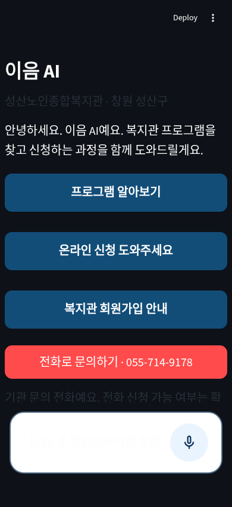
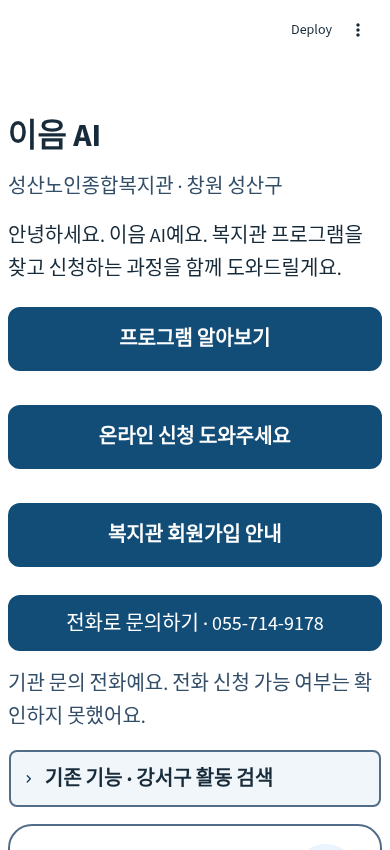

# 성산복지관 가독성 수정 — 2026-11-10

기준 main `49794e1`은 PR #17 병합 커밋입니다. 별도 브랜치 `fix/seongsan-light-contrast`에서 화면 색상·주요 안내 글씨 크기만 수정했습니다.

## 재현한 원인

저장소에는 `.streamlit/config.toml`의 전역 테마 설정이 없습니다. Streamlit은 사용자의 시스템/선택 테마를 사용합니다. `ui/chat.css`는 캡션 글씨를 `#384454`로 고정하지만 앱 배경은 고정하지 않았습니다. Chromium의 시스템 다크 설정에서 실제 복지관 이름 색 `rgb(56,68,84)`, 앱 배경 `rgb(14,17,23)`을 확인했고 색상쌍 대비는 **1.91:1**, Streamlit 캡션의 `opacity:0.6`까지 합성한 실제 대비는 **1.41:1**로 WCAG AA 일반 텍스트 기준에 미달했습니다. 반대로 일부 공통 입력창·펼침 영역은 밝은 배경만 고정해 다크 테마의 밝은 글씨가 겹칠 수 있는 구조였습니다.

실제 사용자 Mac/배포 설정을 조회한 것은 아닙니다. 로컬 Chromium에서 같은 테마 혼합 문제를 재현한 결과입니다.

## 변경 방식과 범위

성산 본문을 `st.container(key='seongsan_light')`로 감싸고 `ui/seongsan_light.css`를 성산 화면에만 로드합니다. 테마를 전역에서 강제하지 않습니다. 앱/헤더/고정 입력창 배경도 해당 컨테이너가 있을 때만 밝게 적용합니다. 컨테이너 안의 본문·제목·캡션·경고·버튼·공식 링크·펼침 영역·음성인식 수정창에 명시적인 전경/배경색을 적용하고 캡션의 기본 불투명도 0.6을 1로 고정했습니다. 입력 글씨, placeholder, caret와 음성 버튼도 어두운 시스템 색에 의존하지 않습니다.

일반 본문은 기존 20px, 주요 ‘지금 할 일’은 22px, 단계 제목 23px, 앱 제목 32px입니다. 키보드용 본문 건너뛰기 링크는 18px로 맞췄습니다. 큰 버튼(기존 56~64px 이상)과 포커스 표시를 유지합니다. 비활성 버튼도 읽을 수 있게 색과 불투명도를 지정하지만 비활성 동작은 그대로입니다.

새 스타일에는 전체 `*` 선택자가 없고 서비스 컨테이너 또는 이를 포함한 앱으로 범위를 한정했습니다. **!important는 주요 안내 글씨 크기 한 곳**에만 사용하며, 기존 공통 `.stMain p {font-size:20px!important}`를 좁게 덮기 위해 필요합니다. `ui/chat.css` 자체는 변경하지 않아 기존 강서구의 스타일/동작을 보존합니다. 데이터·검색·세션/단계 로직·Gemini·음성·Secrets·의존성은 변경하지 않았습니다.

`[data-testid]`, 컨테이너 key 클래스와 `:has()`를 사용하므로 Streamlit 버전 변경 시 재검증이 필요합니다. 현재 고정 버전에서 검사했으며 Safari 실기기 호환성을 검증했다고 의미하지 않습니다.

## 대비 계산

WCAG의 sRGB 선형화와 상대 휘도 공식을 사용합니다. `(밝은 휘도+0.05)/(어두운 휘도+0.05)`로 계산하고, 브라우저 검사에서는 투명 배경을 상위 요소 배경 및 부모 opacity와 합성한 뒤 실제 computed color를 비교합니다.

| 요소 | 글씨 / 배경 | 대비 |
|---|---|---:|
| 기존 다크 복지관 이름 | #384454 (opacity 0.6) / #0e1117 | 1.41:1 (색상쌍만 1.91:1, 실패) |
| 수정 본문 | #172b3a / #ffffff | 14.55:1 |
| 복지관 이름·검증 수준 등 캡션 | #334e68 / #ffffff | 8.64:1 |
| 큰 버튼·공식 페이지 버튼 | #ffffff / #124d78 | 8.90:1 |
| 경고문 | #633600 / #fff4d6 | 9.31:1 |
| 비활성 버튼 | #475569 / #e2e8f0 | 6.15:1 |
| 일반 출처 링크 | #075985 / #ffffff | 7.56:1 |

연한 채팅 배경 위에서는 위 표와 수치가 다르므로 실제 렌더링 색도 별도로 검사했습니다. 본문/주요 안내/활성 버튼은 7:1 이상을 확보했으며 비활성 버튼도 4.5:1 이상입니다. 플랫폼 자체의 Deploy 도구 글씨 크기는 제품 본문 크기 검사에서 제외했습니다.

## 실제 브라우저 수정 전후 (390×850, 시스템 다크)

로컬 앱의 공개 안내 화면이며 개인정보·음성·외부 사이트 화면은 포함하지 않았습니다.

| 수정 전 | 수정 후 |
|---|---|
|  |  |

## 테스트

- 전체 Python 자동 테스트 **186개 통과**. 기존 신청 흐름·강서구 검색/추천·세션·음성 모의 검사를 포함합니다.
- 시스템 light/dark × 320/390/768px **6개 흐름**: 첫 화면/단계/펼친 출처의 텍스트 약 490개 샘플, 본문 최소 18px·주요 안내 22px, 입력/placeholder, 버튼 크기·범위·겹침, 가로 스크롤, 회원 게이트와 강서구 전환 시 테마 격리를 검사합니다. 대비 미달 0건, 최저 6.15:1입니다.
- Streamlit 서버 자체 `--theme.base=dark`와 시스템 light/dark 조합도 390px **2개 흐름**, 163개 샘플에서 통과했습니다. 전역 설정을 바꾸는 방식으로 해결한 것이 아닙니다.
- 기존 성산 신청/강서구 왕복 Chromium **6개 흐름 통과**(320/390/768px × 키 없음/모의 Gemini).
- 문법 검사 및 git diff --check 통과. 신규 브라우저 회귀 코드는 `tests/browser_contrast.cjs`입니다. 상세 측정 JSON은 실행 시 `/workspace/work/contrast/report.json`에 생성합니다.

실제 Mac Safari, iPad/iPhone Safari·Android 실기기, Streamlit Community Cloud, 실제 Gemini/STT/TTS 호출은 미검증입니다. 모바일 뷰포트의 Chromium 검사와 실제 기기의 키보드·시스템 접근성 설정 검사는 다릅니다. 배포 후 첫 화면·각 단계·공식 출처를 시스템 다크와 라이트에서 확인해야 합니다. 화면 기능은 추가하지 않았습니다.
